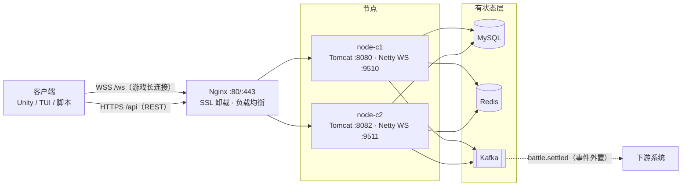
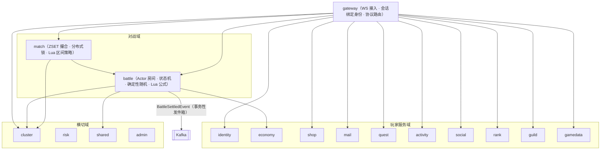
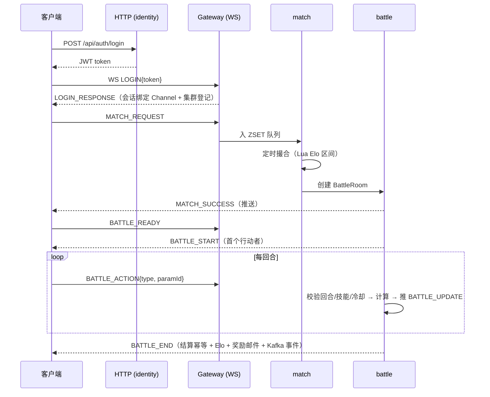

# TurnBasedGameServer_NT

本项目是一个回合制在线 PvP 对战游戏的服务端，由早期项目 `TurnBasedGame` 重写而来：沿用玩法与数据模型，骨架改为模块化单体（Spring Modulith），游戏接入层改为 WebSocket + Protobuf，并在原有「账号 / 匹配 / 对战」之外补齐了邮件、公会、商城、任务、排行、社交聊天、风控、集群等系统。原项目仅作玩法与资产参照。

> Java 25 · Spring Boot 4.1.1 · Spring Modulith · Netty 4.2（WebSocket）· Protobuf · MySQL + MyBatis-Plus + Flyway · Redis · Kafka · Lua（沙箱热更）· JWT · Micrometer / Prometheus

## 核心特性

- **双协议接入**：HTTP(REST) 处理无状态业务（注册、登录、配置字典、商城、邮件、社交、排行、公会等）；WebSocket(`/ws`) 承载游戏长连接（匹配、对战、服务端推送）。两者经 Nginx 统一入口（`/api` 与 `/ws`）。
- **统一协议信封**：所有 WS 消息是一个 Protobuf `GameMessage`，携带 `version / requestId / type / traceId`；登录以外的消息体**不携带 userId**，身份一律由服务端会话（Netty Channel 属性）决定。
- **模块化单体**：16 个业务模块 + `shared`，模块间只经对方的公开 API 或领域事件通信，`internal` 子包禁止跨模块引用，由 Spring Modulith + ArchUnit 在测试中校验。
- **对战房间为单线程 Actor**：按 `battleId` 播种随机数，使对局可复现；回合归属、技能归属与冷却在房间内二次校验，越权操作回 `ERROR` 帧。
- **结算幂等**：幂等键 + 唯一约束 + 单事务；战斗奖励经事务性发件箱在事务提交后异步派发，并外置到 Kafka `battle.settled`。
- **Lua 可热更**：战斗公式与匹配区间策略以 Lua 脚本承载，运行在剥离危险全局的沙箱中，可经管理后台热更；执行异常回退 Java 兜底公式。
- **集群**：会话与战斗归属按节点登记于 Redis，跨节点推送 / 指令转发 / 同账号跨节点顶号均经集群路由；已在双 VM 环境实测跨机对战。
- **风控**：登录失败审计 + 滑动窗口限流（战斗 30 次/10s、匹配 10 次/min、聊天 8 条/10s）。
- **可观测**：Spring Boot Actuator + Micrometer 业务指标，`traceId` 贯穿请求与日志。
- **Web 管理后台**（Thymeleaf）：登录 / 控制台 / 玩家管理 / 战报 / 风控 / Lua 热更。

## 系统架构

### 运行时（双节点 / 可水平扩展）



- 客户端只感知一个入口（Nginx）：游戏走 `wss://host/ws`，REST 走 `/api`；会话落在哪个节点由负载均衡决定，跨节点推送 / 指令转发由集群路由（Redis）处理。
- 有状态层集中部署，游戏节点可水平增加。

### 代码（模块化单体，Spring Modulith）



## 技术选型

| 分类 | 技术 | 用途 |
|---|---|---|
| 核心框架 | Spring Boot 4.1.1 / Java 25 | 应用容器与依赖整合 |
| 模块化 | Spring Modulith + ArchUnit | 模块边界定义与校验 |
| 网络 | Netty 4.2（WebSocket） | 游戏长连接接入 |
| Web | Spring Web (Tomcat) | REST API 与管理后台 |
| 序列化 | Protobuf | WS 消息编解码 |
| 数据库 | MySQL + MyBatis-Plus | 持久化与原子 SQL / 乐观锁 |
| 迁移 | Flyway | 数据库版本化（V1–V6） |
| 缓存 / 协调 | Redis (Lettuce) | 匹配队列、会话 / 战斗路由、幂等键、分布式锁 |
| 消息 | Kafka | 领域事件外置（`battle.settled`） |
| 脚本 | Lua（luaj + 沙箱） | 战斗公式 / 匹配策略，运营热更 |
| 认证 | JWT (jjwt) + BCrypt | 无状态认证与口令哈希 |
| 后台模板 | Thymeleaf | 管理后台页面 |
| 可观测 | Actuator + Micrometer | 健康检查与业务指标 |
| 构建 | Maven | 构建与依赖管理 |

## 已实现系统

| 系统 | 状态 | 说明 |
|---|---|---|
| 账号 / 认证 | 已实现 | JWT + BCrypt；自助注册，注册即发默认角色 + 初始金币 / Elo |
| 会话 / 长连接 | 已实现 | 身份绑定 Channel；读空闲断开；断线重连按服务端快照恢复盘面 |
| 匹配 | 已实现 | Redis ZSET 去重 + 分布式锁；Lua 动态 Elo 区间 |
| 对战 | 已实现 | 单线程 Actor 房间、确定性随机、回合 / 技能 / 冷却校验、回合与房间超时 |
| 战斗结算 | 已实现 | 幂等三重保险 + 标准 Elo；奖励走事务性发件箱 |
| 背包 / 道具 | 已实现 | 原子增减；战斗内 POTION 走真实背包；装饰道具（头像框）装备 |
| 商城 | 已实现 | 订单号幂等；扣费与发货同事务 |
| 邮件 | 已实现 | 附件幂等领取、过期清理、红点推送 |
| 好友 / 聊天 | 已实现 | 双向好友 + 申请提醒；世界 / 私聊 + 限流 |
| 公会 | 已实现 | 创建 / 搜索 / 入会申请审批 / 成员管理 / 公告 / 公会聊天（等级经验未做） |
| 任务 / 成就 | 已实现 | 行为驱动进度，条件 UPDATE 防重复领奖 |
| 排行榜 | 已实现 | SQL 下推 + Redis 短 TTL 缓存 |
| 资料 / 战绩 | 已实现 | 玩家资料、对战历史、单局战报（仅参与者） |
| 配置字典 | 已实现 | 技能 / 道具 / 职业模板只读查询 |
| 签到 / 公告 | 已实现 | 连签加成；公告定时生效 + 全体广播 |
| GM 后台 | 已实现 | Web 六页，管理员令牌隔离 |
| 风控 | 已实现 | 滑动窗口限流 + 登录失败审计 |
| 集群 | 已实现 | 跨节点路由 / 推送 / 顶号；双 VM 实测 |
| 可观测 | 已实现 | Prometheus 指标 + traceId |

待补：拍卖行、赛季排名、公会玩法深度等。

## 项目结构

```
src/main/java/com/game/nt/     16 个业务模块 + shared（每个模块：公开 API + internal 实现）
  ├── gateway/                 Netty WS 接入、协议路由、会话绑定身份
  ├── identity/                注册 / 登录 / JWT
  ├── match/                   撮合（ZSET + 分布式锁 + Lua 区间）
  ├── battle/                  Actor 房间、状态机、结算
  ├── economy/ shop/ mail/     背包道具 / 商城 / 邮件
  ├── social/ guild/ rank/     好友聊天 / 公会 / 排行
  ├── quest/ activity/         任务成就 / 签到公告
  ├── gamedata/                技能 / 道具 / 职业配置字典
  ├── cluster/ risk/ admin/    集群路由 / 风控 / GM 后台
  └── shared/                  错误码、幂等键、Lua 沙箱、推送端口、可观测
src/main/proto/game.proto      协议单一真源（protoc 构建期生成 Java）
src/main/resources/
  ├── application*.yml         配置（密钥走环境变量 / .env，详见“快速开始”）
  ├── lua/                     damage_formulas.lua / match_strategy.lua（热更脚本）
  └── db/migration/            Flyway 迁移 V1–V6
tools/                         TUI 启动器 / 证书脚本（本地测试脚本不入库）
deploy/                        第二节点编排
```

## 协议 v2 要点

- 传输：WebSocket 二进制帧，每帧一个完整 `GameMessage`（WS 帧自带边界，无长度前缀）。
- 信封字段：`version`(=2) / `requestId`（请求-响应关联，推送为 0）/ `type`（`MessageType` 枚举）/ `traceId` / `token`（仅 LOGIN 携带）。
- 枚举首值为 `*_UNSPECIFIED = 0`；字段号只增不改，破坏性变更升 `version`。
- 关键消息号：`HEARTBEAT=1, ERROR=2, LOGIN=10, MATCH_REQUEST=20, MATCH_SUCCESS=22, BATTLE_READY=30, BATTLE_START=31, BATTLE_ACTION=32, BATTLE_UPDATE=33, BATTLE_END=34, BATTLE_REJOIN=36`（完整表见 `game.proto`）。

## 核心业务流程



- 行动权由 `BATTLE_UPDATE/BATTLE_START` 的 `currentActorUserId` 决定；非当前回合 / 冷却中 / 道具不足的操作会回 `ERROR`，不静默。
- 回合超时与断线重连窗口均由服务端定时任务判定；重连后发 `BATTLE_REJOIN` 恢复盘面。

## 数据库

MySQL，Schema 由 Flyway 迁移管理（`src/main/resources/db/migration/`）：

| 迁移 | 内容 |
|---|---|
| V1 | 初始 schema（用户、角色、技能、道具、战斗记录等） |
| V2 | 邮件 |
| V3 | 社交与玩法系统（好友、聊天、任务、商城等） |
| V4 | 事务性发件箱事件表（`event_publication`） |
| V5 | 集群与风控 |
| V6 | 公会入会申请与聊天 |

应用启动时按版本号顺序执行迁移；运行时数据访问走 MyBatis-Plus（原子 SQL + 乐观锁）。实时态（会话、匹配队列、战斗路由、幂等键）在 Redis，战斗奖励事件外置到 Kafka。

## 快速开始

### 一键集群（容器内构建，无需本地 JDK/Maven）

```bash
docker compose up -d --build     # MySQL + Redis + Kafka + Nginx + 双节点
curl http://localhost:8081/actuator/health
```

- 游戏入口 `ws://localhost/ws`，REST `http://localhost/api/**`，管理后台 `http://localhost/admin/login`。
- 密钥与口令**不入库**：复制 `.env.example` 为 `.env` 并填入 `MYSQL_ROOT_PASSWORD / DB_PASSWORD / REDIS_PASSWORD / JWT_SECRET`；集群配置为缺失即拒绝启动（`APP_STRICT_CONFIG=true`）。
- 首次以 `local` profile 启动会播种测试账号与管理员（账号 / 口令见本地配置，**仅限开发，勿用于生产**）。

### 本地裸跑（调试）

前置 JDK 25 + Maven + MySQL（Redis 可选，缺失时降级），建库与本地口令见 `application-local.yml`（该文件已被 `.gitignore` 排除，不入库）：

```bash
mvn spring-boot:run -Dspring-boot.run.profiles=local
# 业务 :8080 · 管理 :8081 · 游戏 WS :9510
```

双实例本地演示与双 VM 部署可按 `deploy/` 与 `docker-compose.yml` 执行。

## 测试

```bash
mvn test                         # 回归：模块边界 / 战斗并发 / 撮合 / 商城 / Lua / Elo / 集群 / 协议兼容
# Python 冒烟/压测/验收脚本为本地开发工具，不入库
```

## 许可证

MIT，见 [LICENSE](LICENSE)。


